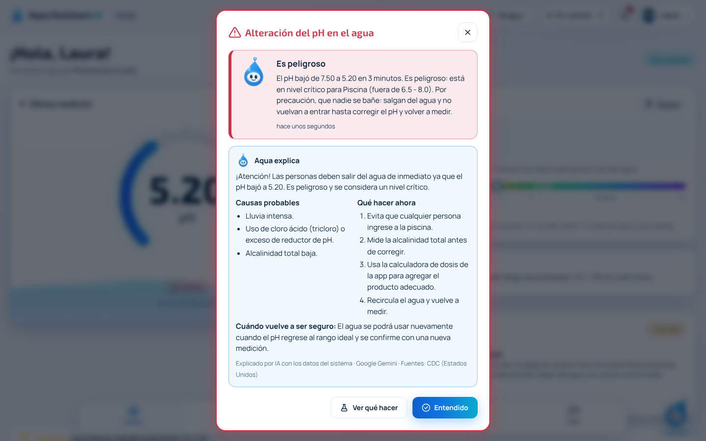

# RF-30 · Alarma por alteración del pH
<!-- etiquetas: requerimiento funcional, historia de usuario, estado: hecho -->

## Historia de usuario

**Como** dueño de una piscina, un acuario u otra agua con un medidor dentro, **quiero** que la app me avise de inmediato con sonido y que Aqua me diga si el cambio es peligroso cuando el pH se altera, **para** sacar a las personas del agua o proteger a los peces a tiempo.

## Descripción

Con el medidor en el agua («Medir cada 10 s», que sigue aunque se cambie de pantalla), cada medición se compara con las de la última hora. Si el pH cambia 0,5 o más (por ejemplo, algo cayó al agua), o si entra en nivel crítico aunque no haya mediciones en la última hora, se crea la alerta «Alteración del pH en el agua». Dice si es peligroso según los rangos del perfil (nivel crítico = peligroso) y qué hacer según el tipo de agua: en una piscina, que nadie se bañe y salgan del agua; en un acuario, que los peces corren peligro; en agua potable, no tomarla; en riego, no regar. Funciona con cualquier perfil. En la app suena una sirena generada en el navegador (al volumen del equipo, también en el celular, con un elemento de audio y Web Audio de respaldo), aparece una ventana que no se cierra sola y Aqua lo dice en voz alta; la alarma se repite cada pocos segundos hasta pulsar «Entendido». En el celular o computador llega un aviso urgente que queda en pantalla y vibra, aunque la app esté cerrada (si se activaron los avisos). La misma alerta no se repite en ese lugar durante 30 minutos, salvo que se vuelva peligrosa. Debajo, «Aqua explica» amplía el aviso con IA: un resumen, las causas probables para ese tipo de agua, qué hacer ahora y cuándo vuelve a ser segura, con las mediciones de la última hora, el veredicto de peligro del sistema y las normas que aplican; Aqua lo lee después del aviso. Si la IA no está disponible, la explicación sale de las reglas del perfil. En Configuración se puede apagar el sonido en cada dispositivo y probar la alarma. Si la app está abierta en otro equipo, revisa las alertas cada 15 segundos. Con el medidor conectado al mismo equipo, el aviso es inmediato.

## Criterios de aceptación

- [x] Una caída o subida de 0,5 o más en la última hora, o la entrada en nivel crítico, crea una sola alerta «Alteración del pH en el agua».
- [x] El mensaje dice si es peligroso según el perfil y qué hacer según el tipo de agua.
- [x] En la app suena la alarma, aparece la ventana y Aqua lee el mensaje; «Entendido» la detiene y marca la alerta como leída.
- [x] El aviso del celular o computador es urgente y queda en pantalla hasta tocarlo.
- [x] «Aqua explica» muestra y lee el resumen, las causas probables, los pasos y cuándo vuelve a ser segura (con IA o, sin ella, con las reglas del perfil).
- [x] Los navegadores solo dejan sonar una página después de tocarla una vez; si no, la ventana lo indica.
- [x] La sirena suena también en el celular (en iPhone con Safari 17 o más, aunque esté en silencio).
- [x] Una medición en nivel crítico hace sonar la alarma aunque la anterior sea de hace más de una hora.

## MockUp

**MockUp48** · Alarma en una piscina: el pH bajó de 7,50 a 5,20, con la explicación de Aqua (IA)

---
**Requerimiento:** RF-30 · **Tipo:** Funcional · **Estado:** Hecho · Detalle en [docs/Requerimientos.md](https://github.com/WillC372/FrontendPatSft/blob/main/docs/Requerimientos.md#rf-30)
