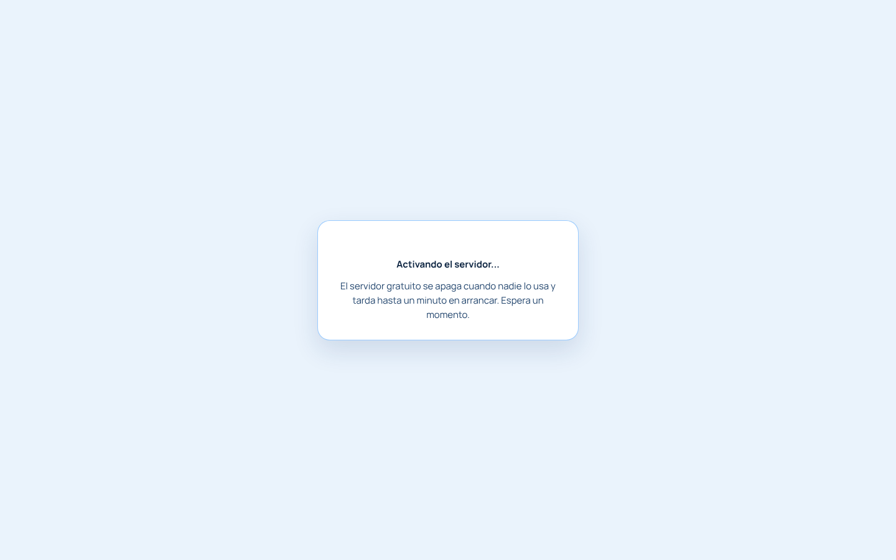

# RNF-03 · Disponibilidad
<!-- etiquetas: requerimiento no funcional, historia de usuario, estado: hecho -->

## Historia de usuario

**Como** usuario, **quiero** que la app esté disponible cuando la abra y me avise si el servidor está arrancando, **para** saber que debo esperar un momento y no ver un error.

## Descripción

Frontend en Vercel, backend y servicio de IA en Render y base PostgreSQL en Neon. Render apaga un servicio gratuito tras 15 minutos sin uso. Desde el 20 nov 2026, a pedido del dueño, el flujo de GitHub «Despertar el backend y la IA» mantiene despiertos al backend y al servicio de IA (los visita cada 4 minutos), así que responden al instante. Con la variable KEEP_AWAKE_MODE=3h de GitHub vuelve el modo ahorro, para que las 750 horas gratis al mes alcancen: los servicios se duermen cuando nadie los usa, el flujo los despierta cada 3 horas para enviar los recordatorios e importar los datos del USGS, y la primera visita tarda alrededor de un minuto mientras la app muestra «Activando el servidor…».

## Criterios de aceptación

- [x] /actuator/health/liveness responde 200 sin iniciar sesión.
- [x] Si el servidor tarda, la app avisa en lugar de mostrar un error.
- [x] Dormido, el backend despierta con la primera visita y la app sigue sola cuando responde.
- [x] En modo «siempre despierto», el backend y el servicio de IA responden sin esperar el arranque.

## MockUp

**MockUp29** · Aviso mientras el servidor arranca

---
**Requerimiento:** RNF-03 · **Tipo:** No funcional · **Estado:** Hecho · Detalle en [docs/Requerimientos.md](https://github.com/WillC372/FrontendPatSft/blob/main/docs/Requerimientos.md#rnf-03)
