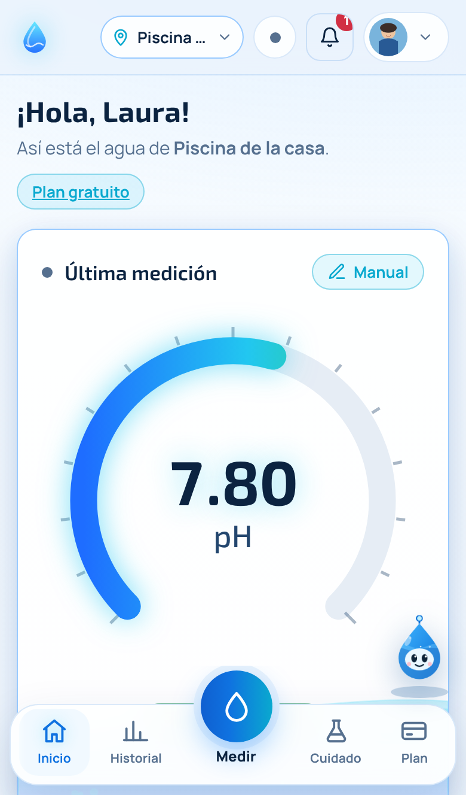
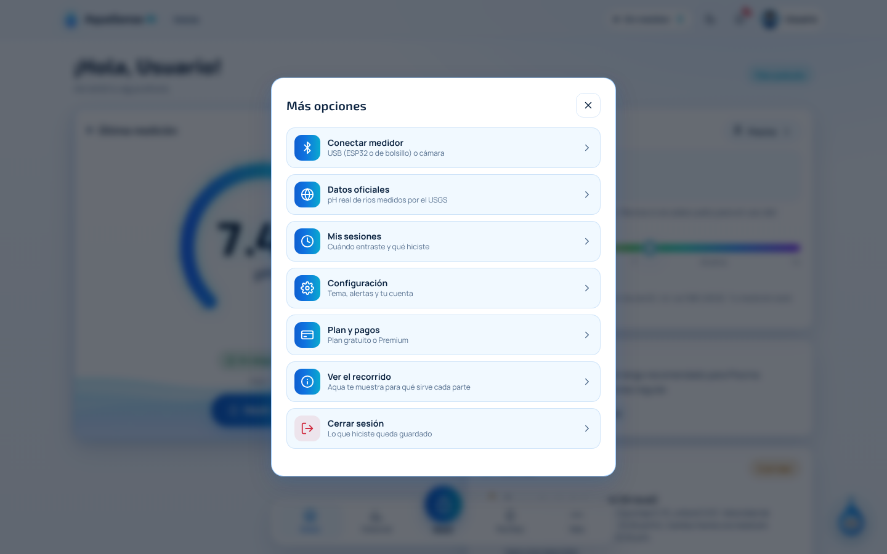

# RNF-04 · Usabilidad, accesibilidad y diseño adaptable
<!-- etiquetas: requerimiento no funcional, historia de usuario, estado: hecho -->

## Historia de usuario

**Como** usuario de computador o celular, **quiero** una interfaz clara que funcione en cualquier pantalla, **para** usarla cómodamente donde esté.

## Descripción

Navegación con una barra inferior de 4 pestañas con su ícono (Inicio, Historial, Medir, Plan y Admin para administradores), igual en celular y computador. Arriba, el botón del lugar cambia de lugar y lleva a «Cuidado de este lugar» y a «Crear, editar o compartir lugares» (con los Perfiles de uso); el menú de la cuenta tiene «Mi cuenta», «Configuración» (con Medidor y Actividad y sesiones) y «Cerrar sesión». Los Datos oficiales están en la Biblioteca normativa de Aqua. Las funciones de Aqua se agrupan en «Analizar mi agua» (diagnóstico y recomendaciones, anomalías, predicción), «Más herramientas» (informes, biblioteca) y «Análisis avanzado» (LSTM, Isolation Forest, simulador); «Consumo y costos» es solo para administradores. El tema claro u oscuro se elige también antes de iniciar sesión. La sesión se cierra solo desde el menú del usuario (la inicial o el nombre, arriba a la derecha). Tema claro predeterminado y oscuro opcional, navegación por teclado y lector de pantalla. Revisión con axe-core: 0 hallazgos en 18 pantallas, el recorrido, el panel de Aqua y las hojas «Medir» y «Más», en tema claro y oscuro, en computador y teléfono.

## Criterios de aceptación

- [x] Todas las pantallas se usan en un celular sin desplazamiento horizontal.
- [x] Cada control tiene nombre accesible y foco visible.
- [x] El contraste cumple en ambos temas.

## MockUp

**MockUp30** · Inicio en un celular

**MockUp37** · Menú del usuario con «Cerrar sesión» y la barra de pestañas

---
**Requerimiento:** RNF-04 · **Tipo:** No funcional · **Estado:** Hecho · Detalle en [docs/Requerimientos.md](https://github.com/WillC372/FrontendPatSft/blob/main/docs/Requerimientos.md#rnf-04)
