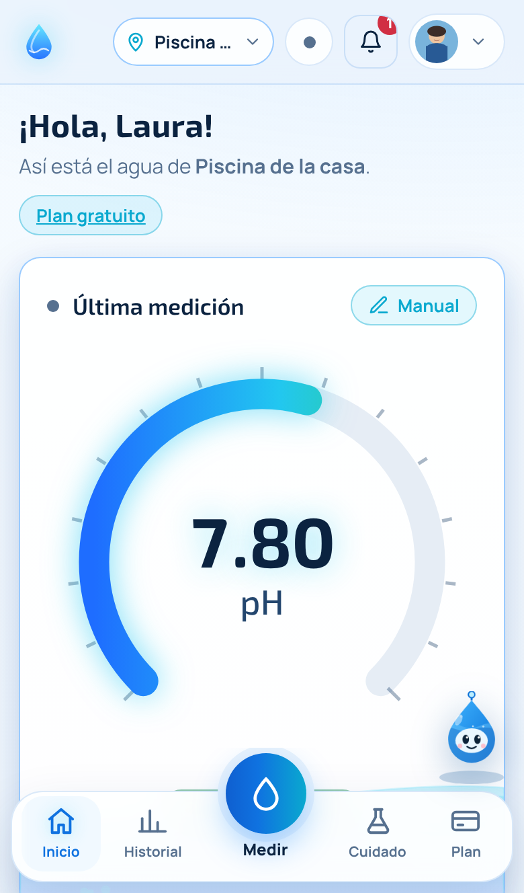
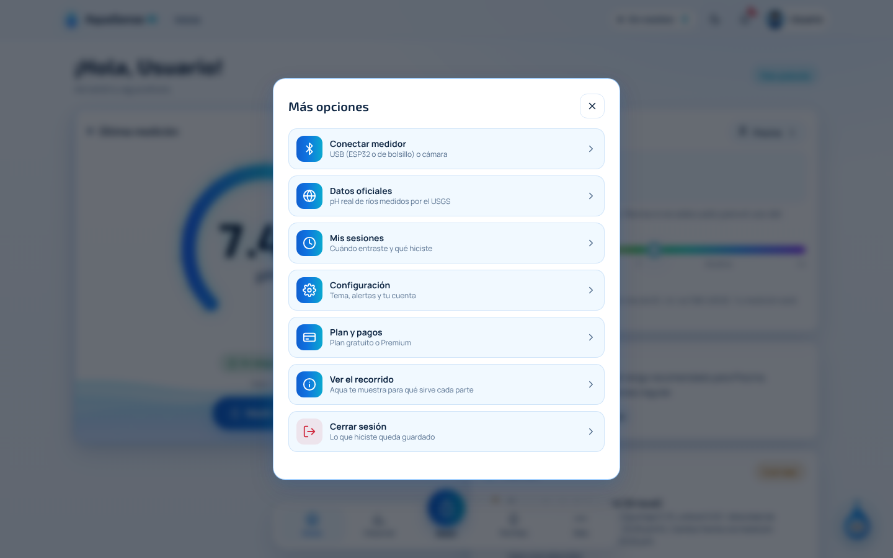
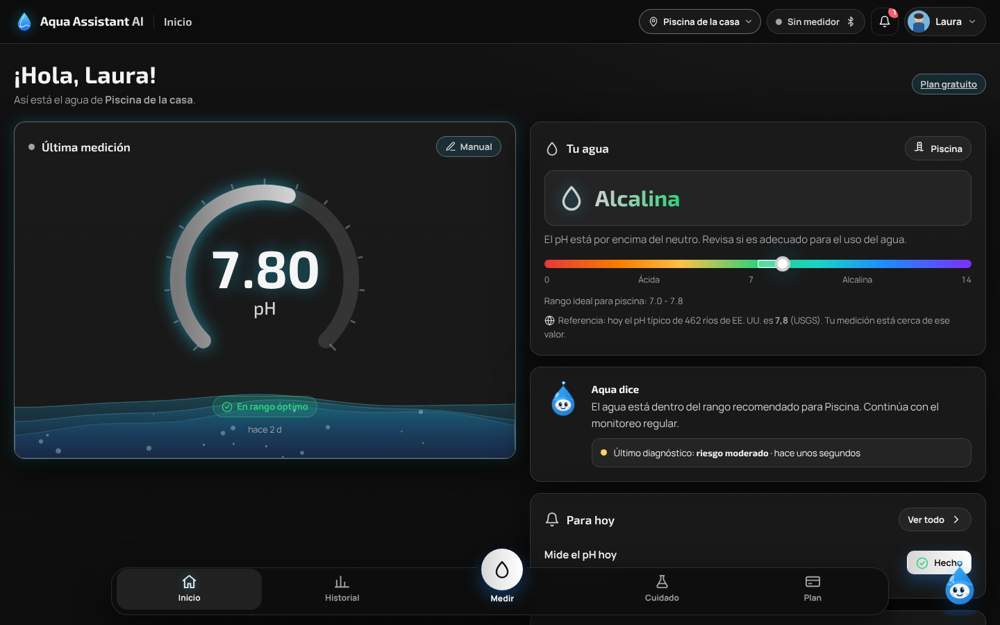
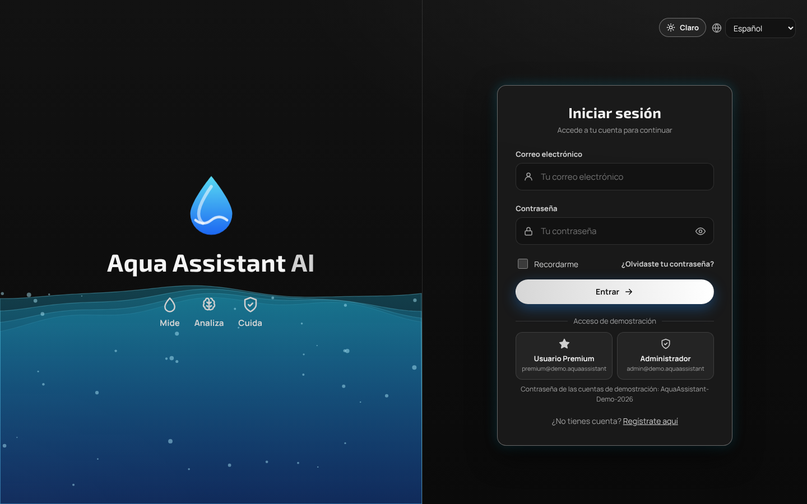

# RNF-04 · Usabilidad, accesibilidad y diseño adaptable
<!-- etiquetas: requerimiento no funcional, historia de usuario, estado: hecho -->

## Historia de usuario

**Como** usuario de computador o celular, **quiero** una interfaz clara que funcione en cualquier pantalla, **para** usarla cómodamente donde esté.

## Descripción

Navegación con una barra inferior con su ícono: Inicio, Historial, Medir, Cuidado y Plan para las personas, e Inicio, Historial, Medir, Plan y Admin para el administrador (que abre Cuidado desde el botón del lugar); igual en celular y computador. Arriba, el botón del lugar cambia de lugar y lleva a «Crear, editar o compartir lugares» (con los Perfiles de uso); el menú de la cuenta tiene «Mi cuenta», «Configuración» (con Medidor y Actividad y sesiones) y «Cerrar sesión», y solo un menú de arriba está abierto a la vez. Los Datos oficiales están en la Biblioteca normativa de Aqua. Las funciones de Aqua se agrupan en «Analizar mi agua», «Más herramientas» y «Análisis avanzado»; «Consumo y costos» es solo para administradores. Aqua saluda «Hola, (nombre)» la primera vez que se abre en cada sesión y después con frases cortas al azar. Tema claro predeterminado y oscuro (negros, blancos y grises, con brillos cian), que también se elige antes de iniciar sesión. La sesión se cierra solo desde el menú del usuario (la inicial o el nombre, arriba a la derecha). Navegación por teclado y lector de pantalla. Revisión con axe-core (19 nov 2026): 0 hallazgos en 36 pantallas y vistas (acceso, registro, recorrido, panel y chat de Aqua, hoja «Medir», menús de la cuenta y del lugar, ventana de alarma y todas las pantallas), en tema claro y oscuro, en computador y teléfono.

## Criterios de aceptación

- [x] Todas las pantallas se usan en un celular sin desplazamiento horizontal.
- [x] Cada control tiene nombre accesible y foco visible.
- [x] El contraste cumple en ambos temas.

## MockUp

**MockUp30** · Inicio en un celular

**MockUp37** · Menú de la cuenta (Mi cuenta, Configuración y Cerrar sesión) y la barra de pestañas

**MockUp46** · Inicio en tema oscuro (negros y grises con brillos cian)

**MockUp47** · Inicio de sesión en tema oscuro, con el botón claro/oscuro arriba

---
**Requerimiento:** RNF-04 · **Tipo:** No funcional · **Estado:** Hecho · Detalle en [docs/Requerimientos.md](https://github.com/WillC372/FrontendPatSft/blob/main/docs/Requerimientos.md#rnf-04)
