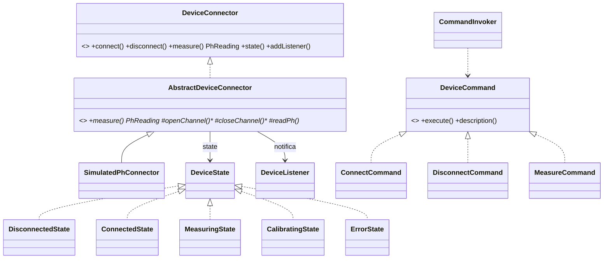

# Patrones de diseño en el cliente

Solo se listan los que cumplen una función real y tienen prueba. El catálogo completo del sistema, incluidos los patrones no implementados y por qué, está en el [repositorio del backend](https://github.com/WillC372/BackendPatSft/blob/main/docs/patrones.md).

| Patrón | Dónde | Problema que resuelve | Clases | Prueba |
|---|---|---|---|---|
| **State** | `device.state` | El dispositivo se comporta distinto según esté desconectado, conectado, midiendo, calibrando o en error; las transiciones inválidas deben rechazarse (no se puede medir sin conectar) | `DeviceState`, `BaseState`, `DisconnectedState`, `ConnectedState`, `MeasuringState`, `CalibratingState`, `ErrorState` | `DeviceConnectorTest` |
| **Template Method** | `device` | Todo conector comparte el flujo de medición: pasar a "midiendo", leer, validar que el pH esté entre 0 y 14, notificar y volver a "conectado" o a "error" | `AbstractDeviceConnector.measure()` (final) con ganchos `openChannel`, `closeChannel`, `readPh` | `DeviceConnectorTest` |
| **Observer** | `device` | La interfaz se entera de cambios de estado y de nuevas lecturas sin acoplarse al conector | `DeviceListener`, `AbstractDeviceConnector.addListener` | `DeviceConnectorTest.followsStateLifecycleAndNotifiesObservers` |
| **Command** | `device.command` | Conectar, desconectar y medir son acciones con registro de resultado (éxito o fallo) que la pantalla muestra en "Actividad reciente" | `DeviceCommand`, `ConnectCommand`, `DisconnectCommand`, `MeasureCommand`, `CommandInvoker` | `commandInvokerRecordsSuccessAndFailure` |
| **Factory Method** | `device` | Crear el conector adecuado según el tipo de dispositivo y rechazar los que no tienen conector | `ConnectorFactory` | `factoryCreatesSimulatorsCachesThemAndRefusesUnavailableHardware` |

Transiciones: `DESCONECTADO → CONECTADO → MIDIENDO → CONECTADO`; `CONECTADO → CALIBRANDO → CONECTADO`; cualquier estado puede pasar a `ERROR` y desde `ERROR` se reconecta o se desconecta. **La calibración existe en la máquina de estados pero ningún conector la implementa todavía** (`supportsCalibration()` es falso).

**Pendientes por hardware:** Adapter (traducir el protocolo de cada medidor), Bridge (separar la abstracción del transporte Bluetooth/USB) y Abstract Factory (familias de conectores). No se crearon vacíos; ver [dispositivos.md](dispositivos.md).
